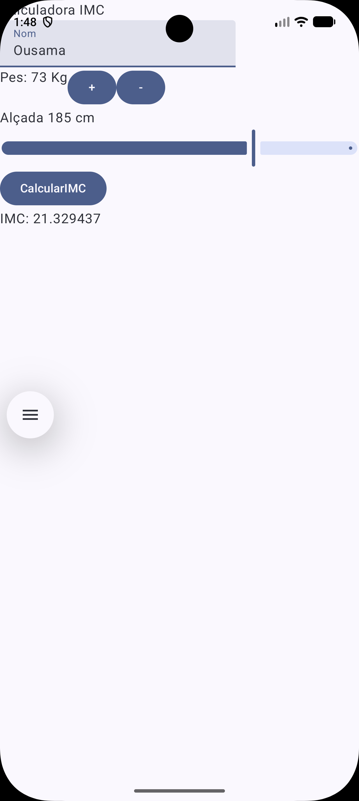
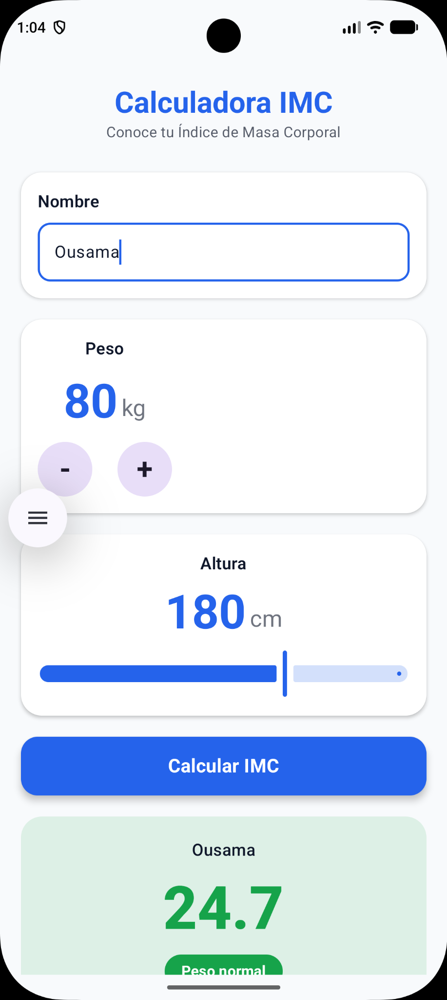

# Calculadora de IMC

## ¿Qué hace la aplicación?

Permite escribir un nombre, modificar el peso mediante los botones **−** y **+**, seleccionar la altura con una barra deslizante y calcular el índice de masa corporal (IMC).

Al pulsar **Calcular IMC**, muestra una tarjeta con el nombre, el resultado con un decimal y la categoría correspondiente. Si el nombre se deja vacío, utiliza el texto **Resultado**.

## Capturas de pantalla

Comparación entre el diseño inicial trabajado en clase y el diseño mejorado de la rama **ui**.

| Diseño inicial · main | Diseño mejorado · ui |
| :---: | :---: |
|  |  |

## Funcionamiento

1. Introducir el nombre (opcional).
2. Ajustar el peso en kilogramos. Los controles permiten valores entre 20 y 300 kg.
3. Seleccionar la altura en centímetros.
4. Pulsar **Calcular IMC**.
5. Consultar el resultado en la tarjeta inferior. La pantalla permite desplazarse para acceder a todo el contenido.

Por ejemplo, con 80 kg y 180 cm, el resultado mostrado es aproximadamente 24,7.

## Ramas del proyecto

El proyecto conserva dos versiones de la interfaz en ramas distintas:

- [`main`](https://github.com/ojaafar/IMCA2/tree/main): diseño inicial trabajado en clase.
- [`ui`](https://github.com/ojaafar/IMCA2/tree/ui): diseño mejorado, colores y una presentación más visual del resultado.

Este README y la captura corresponden a la versión de la rama **`ui`**.

## Tecnologías utilizadas

- **Kotlin** 
- **Jetpack Compose**
- **Android Studio y Gradle**

